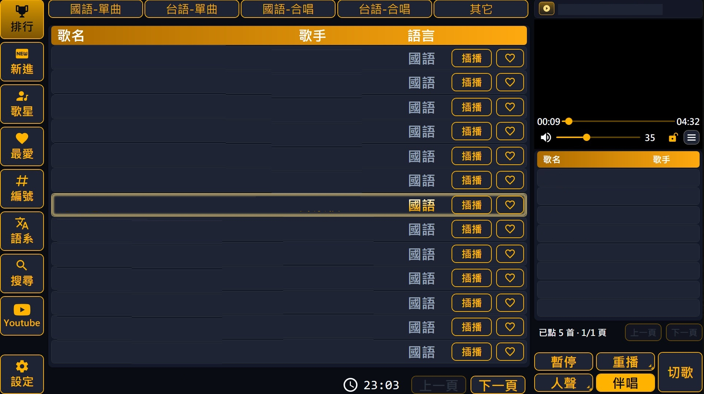
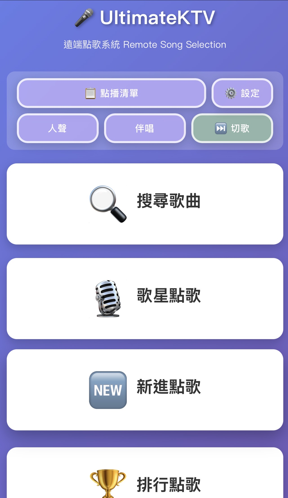
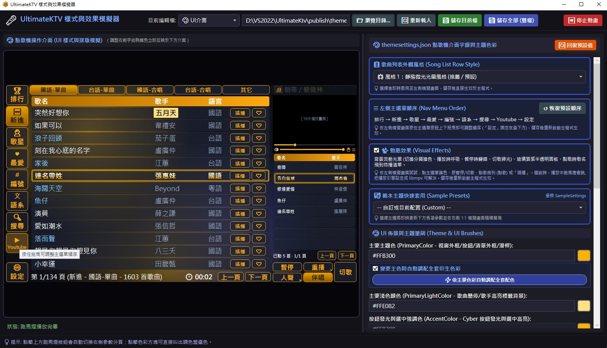

# UltimateKtv

[繁體中文](README.md) | **English**

UltimateKtv is a karaoke (KTV) song-request and playback system for Windows. It runs a touch-friendly control console on one screen and full-screen video on a second screen (TV), lets guests request songs from their phones by scanning a QR code, and can turn almost any YouTube music video into a karaoke track by removing the lead vocal in real time.

It works with song libraries in the CrazyKTV format (Access `CrazySong.mdb` or SQLite `CrazySong.db`).

> The full user guide (settings, `settings.json` options, marquee templates, release packaging) is in the [Traditional Chinese README](README.md). This page covers the overview, installation and building.

## Features

- **Dual-screen playback**: song selection on the console, video on the TV (second screen); the console can show a live preview. Single-screen mode is also supported.
- **Many ways to find songs**: by singer (with singer photos), favorites, song number, language (multi-select), new songs, rankings, and search (Zhuyin / stroke count / alphanumeric / number / keyboard).
- **Waiting list**: insert to top, move down, delete; skip, pause, replay, repeat one. Songs already in the waiting list are marked in every song list (including the phone web page).
- **Vocal / instrumental**: switch with one tap, cycle through multiple audio tracks, remember the current channel as the instrumental track, or lock a channel for all songs.
- **Volume and key**: remembers each song's last volume, volume lock, key up/down, male/female key, fixed key.
- **Remote requests from phones**: scan the QR code to search, request and control playback from a phone browser; optionally shows who requested each song. The web page follows the phone's language.
- **Real-time vocal removal for YouTube**: search YouTube, download to the library (high quality first), and the song is queued automatically when the download finishes. Vocals are removed during playback, so original MVs, live versions and rare songs without a karaoke version can all be sung.
- **Random play**: when the waiting list is empty, songs are picked from rankings, new songs or favorites.
- **Marquee and lyrics**: playback info and request notices on the TV screen. Lyrics come from a subtitle file next to the video (`.ass` > `.ssa` > `.srt`, with `.ass` styling and karaoke effects), the video's default embedded subtitle track, or an `.lrc` file.
- **Recording**: mixes the microphone with the playback into an MP3 (320 kbps).
- **Two playback engines**: libmpv (default) or DirectShow, both with hardware decoding.
- **Visual effects**: flowing ambient background, glass panels and small animations; can be turned off in `themesettings.json`.
- **Themes and languages**: customizable color themes (preview them live with `StyleSimulator.exe`); the interface is available in many languages (files in `Languages/`, and you can add your own).
- **Automatic updates**: checks GitHub Releases and downloads only the components that changed (verified by SHA256). Your song library is never overwritten.

## Screenshots

### Console


### Phone web page


### StyleSimulator theme preview


## Installation

1. Install the [.NET 8 Desktop Runtime](https://dotnet.microsoft.com/download/dotnet/8.0) (x64 runtime for the x64 build, x86 runtime for the x86 build).
2. Download the full package `UltimateKtv_<version>.zip` from [Releases](https://github.com/JordanChiang/UltimateKtv/releases) and extract it to a folder.
3. Run `UltimateKtv.exe` (64-bit) or `UltimateKtv_x86.exe` (32-bit). Both can live in the same folder.

Requirements:

- Windows 10 / 11.
- The x64 build needs the Microsoft Access Database Engine (ACE.OLEDB.12.0) to read an Access library (`CrazySong.mdb`); the x86 build uses the Jet 4.0 engine built into Windows. Neither is needed with a SQLite library (`CrazySong.db`).
- Songs are added and managed with the CrazyKTV song manager (SongMgr, `CrazyKTV_SongMgr.exe`). When `CrazySong.db` exists in the program folder it is used instead of `CrazySong.mdb`; SongMgr can export it from the Access library.

To change the interface language, open the settings window and pick one under **UI Language**.

## Building from source

| Item | Details |
| :--- | :--- |
| Framework | .NET 8 (`net8.0-windows`), WPF |
| Platforms | x86 / x64 (no Any CPU) |
| IDE | Visual Studio 2022 (or the `dotnet` CLI) |
| Tests | xUnit (`Tests/UltimateKtv.Tests`) |

```bash
# Build the whole solution: Updater, StyleSimulator and Tests compile some of the main project's source files
dotnet build UltimateKtv.sln -p:Platform=x64

# Unit tests (skip the YouTube download-format tests that need the network)
dotnet test Tests/UltimateKtv.Tests/UltimateKtv.Tests.csproj -p:Platform=x64 --filter "Category!=Network"
```

x64 produces `UltimateKtv.exe` and uses `Codec\`; x86 produces `UltimateKtv_x86.exe` and uses `Codec_x86\`. `libmpv-2.dll` is too large for GitHub and is downloaded during the build by `Tools/Get-Libmpv.ps1`.

Main dependencies: MaterialDesignThemes, Kestrel (built-in web server), System.Data.OleDb / System.Data.SQLite, YoutubeExplode, NAudio, Newtonsoft.Json, QRCoder; playback uses libmpv or DirectShow with LAV Filters; YouTube downloads use yt-dlp and FFmpeg.

## Contributing

Bug reports, feature requests and pull requests are welcome on [GitHub Issues](https://github.com/JordanChiang/UltimateKtv/issues). Source comments and UI strings are in Traditional Chinese; domain terms follow [GLOSSARY.md](GLOSSARY.md). New UI strings go into `Languages/zh-TW.json` at minimum.

## License

UltimateKtv's own source code is released under the [MIT License](LICENSE).

The bundled third-party components (`Codec/`, `Codec_x86/`, `Tools/` and NuGet packages) are distributed under their own licenses; for example, LAV Filters is licensed under GPL-2.0 (see `Codec/COPYING`).
