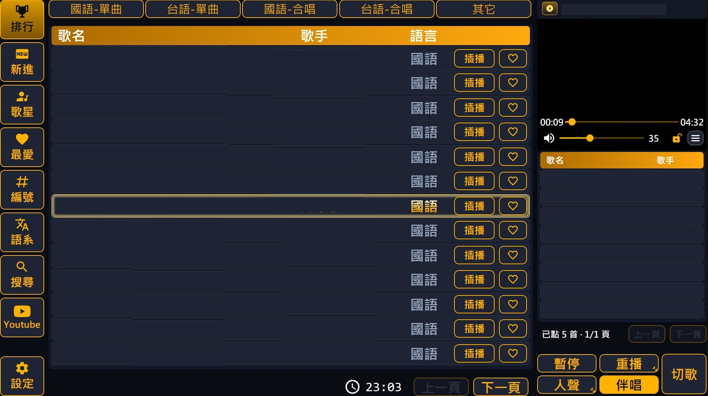
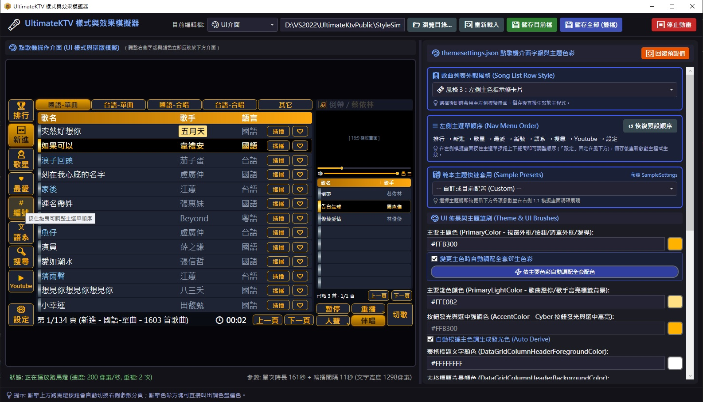

# UltimateKtv

UltimateKtv 是一套針對 Windows 平台開發的專業 KTV 點歌與播放系統，支援雙螢幕獨立顯示、手機網頁端遠端點歌、YouTube 線上影音搜索播放以及硬體加速解碼等多項進階功能，為家庭娛樂提供完整的解決風格。

## 功能簡介 (Features)

- **雙螢幕播放**：主控台點歌與電視畫面 (第二螢幕) 分開顯示，主控台可同步預覽播放畫面；也支援單螢幕模式。
- **多種點歌方式**：歌星 (可顯示歌星照片)、我的最愛、編號、語系 (可複選)、新進、排行、搜尋 (注音 / 筆劃 / 英數 / 編號 / 鍵盤)。
- **待播清單**：插播、順延、刪除；切歌、暫停、重播、單曲循環。
- **人聲 / 伴唱**：一鍵切換，多音軌循環切換，可把目前聲道記為伴唱或固定聲道播放。
- **音量與音調**：每首歌記住最後音量、鎖定音量、升降調、男調/女調與固定音調。
- **手機網頁遠端點歌**：掃描 QR Code 即可用手機點歌與控制播放，可記名顯示點歌者。
- **YouTube 即時消除人聲**：任何 YouTube 原唱 MV 都能當伴唱帶唱，播放時即時消去人聲，不需另找 KTV 版；線上搜尋、下載至歌庫 (預設高畫質優先)，下載完自動點歌。
- **隨機播放**：待播清單沒歌時，自動從排行、新進或我的最愛挑歌。
- **跑馬燈與歌詞**：電視畫面顯示播放資訊與點歌提示；歌曲旁有同名 `.lrc` 檔時顯示歌詞。
- **錄音**：播放時同步錄下歌聲。
- **兩種播放引擎**：DirectShow (預設) 或 libmpv，皆支援硬體解碼。
- **歌庫**：Access (`CrazySong.mdb`)，之後會支援 SQLite。
- **配色與多國語言**：可自訂配色 (`SampleSettings/` 有範本)；介面語言檔放在 `Languages/`，可自行新增。
- **自動更新**：從 GitHub Release 檢查並套用新版本。

---

## 畫面截圖 (Screenshots)

### 主控台點歌


### 手機網頁點歌


### StyleSimulator 配色預覽


---

## 使用說明 (User Guide)

### 設定視窗

**系統控制**
- **退出程式**：完全關閉 UltimateKtv。
- **介面語言**：切換程式介面語言，對應 `Languages/` 目錄下的語言檔。

**顯示與操作**
- **點播螢幕顯示**：開啟時主控台同步顯示播放畫面預覽；關閉可節省系統資源。
- **保持全螢幕播放**：開啟時影片拉伸填滿螢幕；關閉則維持原始長寬比 (可能出現黑邊)。
- **限制游標於主螢幕**：把滑鼠游標限制在主控台螢幕內，避免移到電視畫面干擾播放。

**點歌與歌庫**
- **新進歌曲天數**：歌曲加入後幾天內算「新進歌曲」。
- **歌曲排序方式**：點播次數 (依熱門程度)、加歌日期 (新歌在前)、字數。
- **語系點歌複選**：語系點歌時可同時選多個語系。
- **舊版聲道定義**：以相容舊版點歌系統的方式判定人聲/伴唱音軌。
- **點播次數更新**：播放進度超過多少百分比才計入一次點播次數 (10% - 90%)。
- **播放記錄自動保存次數**：保留最近幾次的播放記錄 (1 - 10)。
- **網路點播使用者記名**：手機點歌時記錄並顯示點歌者名稱。
- **更換歌庫磁碟代號**：歌曲檔案搬到其他磁碟或磁碟代號改變時，指定新的歌庫路徑。
- **隨機播放**：待播清單沒有歌時，自動從指定類別 (國語排行、台語排行、新進歌曲、全部排行、我的最愛) 隨機挑歌，並可指定預設用「人聲」或「伴唱」。

**播放效能**
- **預先讀取**：提早把待播清單的下一首載入記憶體。歌曲放在 NAS 或較慢的裝置上時，開啟可減少換歌延遲。
- **APP記錄檔**：記錄詳細的運作日誌 `UltimateKtv_Log.txt`，供除錯使用，一般保持預設即可。

**影音硬體**
- **音響增益值**：全域音量增益 (100 - 500)，整體音量偏小時可調高。
- **播放引擎**：DirectShow (預設) 或 libmpv。找不到 `libmpv-2.dll` 時自動改用 DirectShow；變更後需重新啟動。
- **視訊渲染器** (DirectShow)：VMR9 相容性較佳；EVR 效能與畫質較佳，Windows 10/11 建議使用。
- **音訊輸出裝置**：有多個音效輸出時，選擇接擴大機或喇叭的裝置。
- **啟用硬體解碼**：用顯示卡協助解碼，大幅降低 CPU 使用率。
- **硬體解碼方式**：自動偵測、NVIDIA、Intel、DXVA2、D3D11，建議用自動偵測。

**錄音**
- **啟用錄音功能**、**錄音輸入裝置**、**錄音檔存放路徑**：開啟後播放歌曲時同步錄音，存到指定目錄。

**網路服務**
- **遠端點歌伺服器**：開啟區網內的手機點歌服務，畫面會顯示區網 QR Code。
- **公網IP連線**：設定對外連線的埠號。路由器設好轉發後，可用這個埠號產生 QR Code 讓外部網路的朋友連線點歌。

### YouTube 點歌與即時消除人聲
網路上找得到的歌，幾乎都能直接拿來唱：在主畫面的「Youtube」或手機網頁的「YouTube 點歌」搜尋影片並點歌，程式會下載到歌庫 (`YoutubeDownloads/`)，下載完成自動加入待播清單。之後點過的影片會留在點播記錄，再點不必重新下載。

- **即時消除人聲**：播放時即時以分頻方式消去混在正中央的主唱人聲，保留伴奏。只在人聲頻段 (約 200 Hz – 12 kHz) 把左右聲道相減 (L−R)，低於此頻段的大鼓、貝斯與高於此頻段的鈸照原曲保留，不會像全頻相減那樣聲音變薄。原唱 MV、現場版、沒有 KTV 版本的冷門歌，都能當伴唱帶唱。
- **預設就是伴唱**：`YoutubeDefaultNoVocal` 預設開啟，YouTube 歌曲一開播就是消人聲狀態。
- **人聲/伴唱隨時切換**：按「人聲」聽原唱 (立體聲)，按「伴唱」回到消人聲；手機網頁的人聲/伴唱按鈕同樣有效。
- **兩種播放引擎效果一致**：DirectShow 與 libmpv 使用相同的消人聲處理。
- **高畫質下載**：`HighQualityYoutube` 開啟時優先下載 1080p / 720p。

> 消人聲的原理是消去左右聲道相同的聲音，主唱放在正中央的歌曲效果最好；和聲、殘響或錄成單聲道的影片可能會留下部分人聲。

### 主畫面進階操作
- **人聲按鈕 (點擊)**：切換人聲；多音軌的歌曲會循環切換音軌。
- **人聲按鈕 (長按或右鍵)**：開啟進階選單
  - **設定此聲道為伴唱**：把目前聲道記為這首歌的伴唱，寫入歌庫。
  - **固定此聲道播放**：鎖定全系統的聲道輸出 (例如只輸出左聲道)，換歌也維持，直到再按人聲/伴唱解除。
- **音量**：每首歌最後播放的音量會自動記住並寫入歌庫；可鎖定音量讓每首歌都用同一音量。

### 手機網頁點歌
用手機掃描 QR Code 或輸入網址進入網頁版點歌。

- **點歌選單**
  - **搜尋歌曲**：輸入歌名或歌手搜尋，可依語言 (國/台/粵/英/日/韓) 篩選。
  - **歌星點歌**：依類別 (男/女/團體/外國) 瀏覽歌手並顯示歌星照片，沒有歌曲的歌星自動隱藏。
  - **新進點歌**：瀏覽最新加入的歌曲。
  - **排行點歌**：熱門點播排行，「單曲」與「合唱」分開排行。
  - **我的最愛**：點自己收藏的歌曲。
  - **YouTube 點歌**：線上搜尋 YouTube 影片並下載至歌庫，播放時即時消除人聲；可查看點播記錄。
  - **編號點歌**：直接輸入 5 或 6 位數編號點歌。
- **播放控制**
  - **點播清單**：查看已點歌曲，可插播 (移到第一首)、順延 (往後一位) 與刪除。
  - **切歌**、**人聲/伴唱**切換。
  - **設定選單**：音量 +/-、固定音量；升調、降調、原調；遠端結束程式。
- **其他**
  - **使用者記名**：設定開啟記名時，點播清單會顯示每首歌是誰點的。

### settings.json 進階設定
執行目錄的 `settings.json` 是所有設定的存放處，每一項都附有說明。下列設定只能在這裡修改 (改完重新啟動程式)：

| 設定 | 說明 |
| :--- | :--- |
| `ConsoleScreen` / `PlayerScreen` | 主控台與電視畫面使用的螢幕編號 |
| `SoundCurve` / `SoundCurveExponent` | 音量曲線 (線性 / 指數 / 對數) 與指數曲線形狀 |
| `HttpServerIp` / `HttpServerPort` | 遠端點歌伺服器監聽的 IP 與埠號 (預設 `0.0.0.0:8080`，埠號被占用時自動換) |
| `WebDefaultNumOrder` | 手機網頁開啟時直接進入「編號點歌」 |
| `VisualSingerStyle` / `SingerPhotoPath` / `VisualSingerNameFontSize` | 歌星照片顯示、照片目錄與歌星姓名字體大小 |
| `HighQualityYoutube` / `YoutubeDefaultNoVocal` | YouTube 優先下載高畫質、預設消除人聲 |
| `YoutubeSearchCount` / `YoutubeDownloadDir` | YouTube 搜尋筆數 (10 - 100) 與下載目錄 |
| `GitHubRepoUrl` | 檢查更新使用的 GitHub 倉庫 (格式: `Owner/Repo`) |

**跑馬燈與提示**

A. 播放中歌曲跑馬燈 (滾動式)
- `MarqueeTextString1`：點播歌曲且待播清單有歌時的文字範本
- `MarqueeTextString2`：點播歌曲且待播清單沒歌時的文字範本
- `MarqueeTextString3`：隨機播放且待播清單沒歌時的文字範本
- `MarqueeTextStartup`：啟動時在電視畫面顯示的文字範本
- 範本參數：`{0}`=目前歌名、`{1}`=目前歌手、`{2}`=下首歌名、`{3}`=下首歌手、`{4}`=區網網址、`{5}`=外網網址、`{6}`=點歌人、`{7}`=下首點歌人 (`{2}` `{3}` `{7}` 只在 `MarqueeTextString1` 有效)
- 樣式：`MarqueeTextFontFamily` (預設 微軟正黑體)、`MarqueeTextFontWeight` (預設 Bold)、`MarqueeTextFontSize` (12 - 128，預設 46)、`MarqueeTextFontStrokeThickness` (0 - 32，預設 8)、`MarqueeTextFillColor` (預設 `#FFFFFF`)、`MarqueeTextStrokeColor` (預設 `#000000`)
- 動畫：`MarqueeTextTimeHold` (單趟結束後停留毫秒，預設 1000)、`MarqueeTextTimeDuration` (速度 像素/秒，100 - 1000，預設 200)、`MarqueeTextPlayCount` (重複次數 0 - 10，0 為不顯示，預設 2)

B. 點播成功提示
- `MarqueeSongAddedString`：點歌成功時的文字範本 (`{0}`=歌名、`{1}`=歌手、`{4}`=區網網址、`{5}`=外網網址、`{6}`=網路點歌者，預設 `點播歌曲：{1} - {0}`)
- `MarqueeSongAddedFontFamily` (預設 微軟正黑體)、`MarqueeSongAddedFontSize` (12 - 128，預設 46)、`MarqueeSongAddedFillColor` (預設 `#90EE90`)、`MarqueeSongAddedTimeDuration` (顯示秒數 0 - 60，0 為不顯示，預設 3)

C. 系統廣播 (音量 / 音調 / 聲道 / 狀態) 提示
- `MarqueeBroadcastFontFamily` (預設 微軟正黑體)、`MarqueeBroadcastFontSize` (12 - 128，預設 48)、`MarqueeBroadcastFillColor` (預設 `#FFD700`)、`MarqueeBroadcastTimeDuration` (顯示秒數 0 - 60，0 為不顯示，預設 3)

---

## 系統建置環境 (Build Environment)

| 項目 | 說明 |
| :--- | :--- |
| **作業系統 (OS)** | Windows 10 / 11 |
| **開發框架 (Framework)** | .NET 8.0 (`net8.0-windows`) |
| **使用者介面 (UI)** | WPF (Windows Presentation Foundation) |
| **目標平台 (Platform)** | x86 / x64 |
| **開發工具 (IDE)** | Visual Studio 2022 |
| **核心套件 (NuGet)** | <ul><li>`MaterialDesignThemes` / `MaterialDesignColors` (UI 視覺框架)</li><li>`Microsoft.AspNetCore.Server.Kestrel` (內建網頁伺服器)</li><li>`System.Data.OleDb` (Access 歌庫存取)；`System.Data.SQLite` (SQLite 歌庫，之後支援)</li><li>`YoutubeExplode` (YouTube 解析，yt-dlp 失敗時的退路)</li><li>`NAudio` (錄音)</li><li>`Newtonsoft.Json` (網頁點歌 API、更新檢查)</li><li>`QRCoder` (網頁點歌 QR Code 產生)</li></ul> |
| **播放引擎 (DirectShow，預設)** | `CrazyKTV_MediaKit`、`DirectShowLib-2005`、LAV Filters (分離/影像/音訊解碼)、`SoundTouchDS` (升降調)、`AudioMixerDS` (消人聲、增益、限制器)，放在 `Codec/` (x64) 與 `Codec_x86/` (x86) |
| **播放引擎 (libmpv)** | `libmpv-2.dll` 超過 GitHub 檔案上限不在 repo 中，建置時由 `Tools/Get-Libmpv.ps1` 自動下載 (x86 固定 20260412 版) |
| **外部工具** | `Tools/yt-dlp.exe` (YouTube 下載)、`Tools/ffmpeg.exe` (影像與音訊合併) |
| **執行需求** | x64 版讀取 Access 歌庫需安裝 Microsoft Access Database Engine (ACE.OLEDB.12.0)；x86 版使用 Windows 內建的 Jet 4.0 |
| **測試** | xUnit (`Tests/UltimateKtv.Tests`) |

**建置與測試**
```bash
# 需建置整個方案 (Updater、StyleSimulator、Tests 會連結主程式的部分原始檔)；平台只有 x86 / x64
dotnet build UltimateKtv.sln -p:Platform=x64

# 單元測試 (略過需連網的 YouTube 下載格式測試)
dotnet test Tests/UltimateKtv.Tests/UltimateKtv.Tests.csproj -p:Platform=x64 --filter "Category!=Network"
```
x64 輸出 `UltimateKtv.exe`，x86 輸出 `UltimateKtv_x86.exe`；相依 DLL 會在建置後搬到輸出目錄的 `libs\`。

---

## 專案結構 (Project Structure)

原始碼依功能分資料夾，根目錄只放程式外殼 (`App`、`StartupSplash`、`MainWindow.xaml` 與依功能拆開的 `MainWindow.*.cs`)。

| 資料夾 | 內容 |
| :--- | :--- |
| `Playback/` | 播放場次與待播清單 (不依賴 WPF，可單元測試) |
| `Player/` | 播放引擎 (DirectShow / libmpv)、電視畫面視窗、錄音 |
| `Library/` | 資料庫存取與歌庫 (歌曲查詢與寫入) |
| `Settings/` | 設定檔與設定視窗 |
| `Themes/` | 配色、字型與按鈕樣式 |
| `Localization/` | 介面多國語言 (語言檔在 `Languages/`) |
| `Remote/` | 手機網頁遠端點歌的 HTTP 伺服器 (網頁在 `wwwroot/`) |
| `Youtube/` | YouTube 搜尋、下載佇列與縮圖快取 |
| `Marquee/` | 跑馬燈 |
| `Lyrics/` | LRC 歌詞 |
| `Singers/` | 歌星照片與歌星清單 |
| `Update/` | 檢查與下載更新 (套用更新的 `Updater/` 是獨立程式) |
| `Infrastructure/` | 記錄檔、資源監控、電源管理等共用元件 |
| `Tests/` | 單元測試 (xUnit) |
| `StyleSimulator/` | 獨立的配色預覽工具 |

`Codec*`、`Images`、`Languages`、`Tools`、`wwwroot`、`SampleSettings` 與歌庫 `CrazySong.mdb` 是執行時使用的資料與範本，保留在根目錄。

---

## 記錄檔資源使用紀錄 (Resource Usage Log)

程式執行目錄下的 `UltimateKtv_Log.txt` 會記錄程式的資源使用情況，用於追查記憶體洩漏或長時間執行後變慢的問題。

**記錄時機**
- 程式啟動時 (`Startup`)
- 之後每 5 分鐘一筆 (`Periodic`)
- 每首歌曲開始播放時 (`Song started`)
- 程式關閉時 (`Shutdown`)

**格式範例**
```
[21:05:00.123] [INFO] [Resource] Song started: WorkingSet=412MB (Peak=455MB), Private=520MB, ManagedHeap=85MB, GCCommitted=110MB, GC0/1/2=120/40/8, GCPause=95ms, CPU=6.3%, Threads=42, Handles=1180, GDI=210, USER=95, Uptime=1.25h
```

| 欄位 | 說明 |
| :--- | :--- |
| **WorkingSet / Peak** | 目前與最高的實體記憶體用量 |
| **Private** | 程式自己佔用的記憶體，持續上升通常代表記憶體洩漏 |
| **ManagedHeap / GCCommitted** | .NET 物件用掉的記憶體 |
| **GC0/1/2、GCPause** | 記憶體回收的累計次數與累計暫停時間 |
| **CPU** | 與上一筆之間的平均 CPU 使用率 (已除以核心數) |
| **Threads / Handles** | 執行緒數量、系統資源代號數量 |
| **GDI / USER** | 視窗繪圖物件數量，各有 10000 的上限，到了就會畫不出來或當掉 |
| **Uptime** | 程式已執行的時數 |

長時間使用後，比較各筆的 Private、Handles、GDI 是否持續上升，即可判斷是否有資源洩漏。記錄間隔可修改 `ResourceMonitor.Interval` (`Infrastructure/ResourceMonitor.cs`)。
